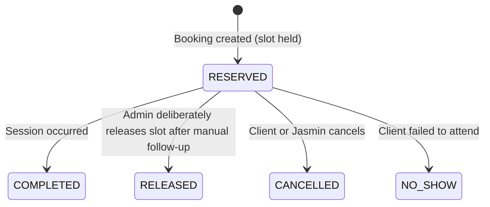
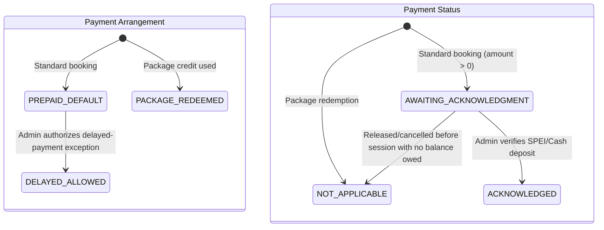
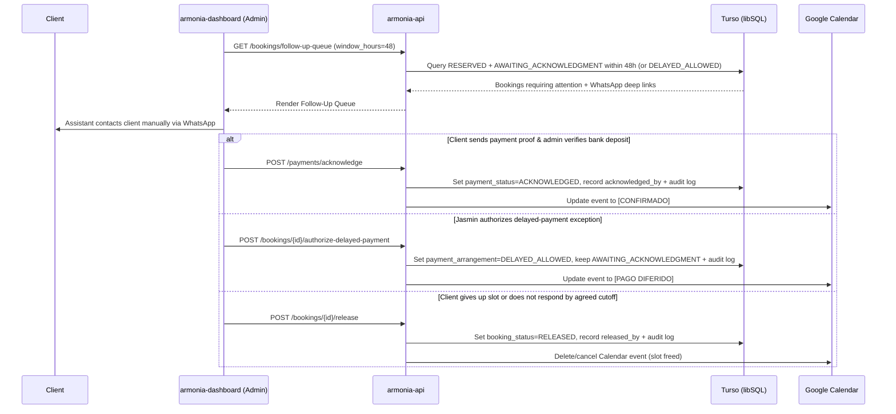

# System Architecture & Technical Design

## Service: `armonia-api`

---

## 1. High-Level Component Topology

```
┌─────────────────────────────────┐       ┌─────────────────────────────────┐
│        armonia-landing          │       │        armonia-dashboard        │
│   (Public Client Experience)    │       │     (Jasmin & Assistant UI)     │
│    Cloudflare Pages (Edge)      │       │     Cloudflare Pages (Edge)     │
└────────────────┬────────────────┘       └────────────────┬────────────────┘
                 │ (Public Booking Flow)                   │ (Google OAuth + Allowlisted Admin Actions)
                 ▼                                         ▼
┌───────────────────────────────────────────────────────────────────────────┐
│                    armonia-api (FastAPI / Python 3.13)                    │
│                                                                           │
│  ┌───────────────────────┐  ┌──────────────────────┐  ┌────────────────┐  │
│  │  Google OAuth Guard & │  │ Orthogonal Booking & │  │  48h Follow-Up │  │
│  │  Turso Allowlist      │  │ Payment State Engine │  │  & Audit Log   │  │
│  └───────────┬───────────┘  └──────────┬───────────┘  └────────┬───────┘  │
│              │                         │                       │          │
│              ▼                         ▼                       ▼          │
│       ┌────────────────────────────────────────────────────────────┐      │
│       │    Database Adapter (libsql-client) + Calendar Adapter     │      │
│       └──────────────┬─────────────────────────────────┬───────────┘      │
└──────────────────────┼─────────────────────────────────┼──────────────────┘
                       │                                 │
         ┌─────────────┴─────────────┐                   ▼
         ▼                           ▼        [Google Calendar API]
[Turso Edge Database]     [Local SQLite3 File]  (Schedule Representation &
(libsql://armonia-db)       (file:local.db)      Recoverable Sync Status)
```

---

## 2. Separated Booking Lifecycle & Payment State Model

A booking and its payment represent distinct operational facts. Combining them into a single state machine makes delayed-payment exceptions and post-session settlements brittle. `armonia-api` models three orthogonal axes on every booking:

1. **`booking_status`**: Is this booking still holding a schedule slot? (`RESERVED`, `RELEASED`, `CANCELLED`, `COMPLETED`, `NO_SHOW`)
2. **`payment_arrangement`**: Is payment expected prior to the session, explicitly allowed afterward, or covered by a package? (`PREPAID_DEFAULT`, `DELAYED_ALLOWED`, `PACKAGE_REDEEMED`)
3. **`payment_status`**: Has the money actually been verified and acknowledged? (`AWAITING_ACKNOWLEDGMENT`, `ACKNOWLEDGED`, `NOT_APPLICABLE`)

### 2.1 Booking Lifecycle (`booking_status`)



### 2.2 Payment Arrangement & Payment Status Lifecycle



### 2.3 Operational Combinations & Google Calendar Side-Effects

| `booking_status` | `payment_arrangement` | `payment_status` | Operational Meaning | Google Calendar Event |
| :--- | :--- | :--- | :--- | :--- |
| `RESERVED` | `PREPAID_DEFAULT` | `AWAITING_ACKNOWLEDGMENT` | Slot held; payment expected prior to session (enters 48h follow-up queue when $\le 48\text{h}$ away) | `[PAGO PENDIENTE] Folio - Cliente` (Yellow) |
| `RESERVED` | `DELAYED_ALLOWED` | `AWAITING_ACKNOWLEDGMENT` | Admin authorized exception; session proceeds with delayed payment tracked | `[PAGO DIFERIDO] Folio - Cliente` (Orange) |
| `RESERVED` | `PREPAID_DEFAULT` / `DELAYED_ALLOWED` | `ACKNOWLEDGED` | Payment verified by admin (`acknowledged_by`, `acknowledged_at`) | `[CONFIRMADO] Folio - Cliente` (Green) |
| `RESERVED` | `PACKAGE_REDEEMED` | `NOT_APPLICABLE` | Covered by multi-session package credit | `[CONFIRMADO] Folio - Cliente` (Green) |
| `RELEASED` | `PREPAID_DEFAULT` | `NOT_APPLICABLE` | Admin deliberately released slot after follow-up; slot freed | Event deleted / cancelled |
| `COMPLETED` | `DELAYED_ALLOWED` | `AWAITING_ACKNOWLEDGMENT` | Session took place under exception; payment still outstanding | `[PAGO DIFERIDO] Folio - Cliente` |
| `COMPLETED` | Any | `ACKNOWLEDGED` | Session took place and payment is settled | `[CONFIRMADO] Folio - Cliente` |

---

## 3. The 48-Hour Payment Follow-Up Workflow

Rather than running a background worker that mutates or expires bookings automatically, the 48-hour attention threshold is a **derived query condition** evaluated when the dashboard requests `GET /bookings/follow-up-queue`:

$$\text{Needs Follow-Up} \iff \text{booking\_status} = \text{RESERVED} \land \text{payment\_status} = \text{AWAITING\_ACKNOWLEDGMENT} \land (\text{scheduled\_at} \le \text{now} + 48\text{h} \lor \text{payment\_arrangement} = \text{DELAYED\_ALLOWED})$$



---

## 4. Buffer-Time Collision Prevention Algorithm

To resolve consultation overruns, individual appointment availability enforces a post-session buffer:

$$\text{Blocked Interval} = [\text{Start Time}, \text{Start Time} + \text{Duration} + \text{Buffer (15 min)}]$$

When checking availability for a requested slot $[T_{\text{start}}, T_{\text{end}}]$:
1. Fetch existing `ONE_ON_ONE` bookings where `booking_status = 'RESERVED'`. (Bookings marked `RELEASED` or `CANCELLED` do not block the schedule.)
2. Compute overlap:
   $$\text{Overlap} \iff \max(T_{\text{start}}, E_{\text{start}}) < \min(T_{\text{end}} + \text{Buffer}, E_{\text{end}} + E_{\text{buffer}})$$
3. If overlap is detected, the slot is rejected with `409 Conflict`.

---

## 5. Security Boundary: Google OAuth & Turso Administrator Allowlist

1. **Server-Side OAuth Secrets**: `GOOGLE_OAUTH_CLIENT_ID`, `GOOGLE_OAUTH_CLIENT_SECRET`, and `SESSION_SECRET_KEY` reside exclusively in `armonia-api`.
2. **Turso `admin_allowlist` Table**: Stores authorized administrator emails (`email PRIMARY KEY`, `full_name`, `role`, `is_active`, `last_login_at`), seeded on startup from `ADMIN_BOOTSTRAP_EMAILS`.
3. **Per-Request Verification**: Every protected administrative endpoint validates the HMAC-signed session token/cookie and verifies that the authenticated email has `is_active = 1` in `admin_allowlist`.
4. **Immutable Audit Trail**: Every administrative action (`ACKNOWLEDGE_PAYMENT`, `AUTHORIZE_DELAYED_PAYMENT`, `RELEASE_BOOKING`, `UPDATE_BOOKING_STATUS`, `ALLOWLIST_CHANGE`) writes a structured row to `admin_audit_log`.
