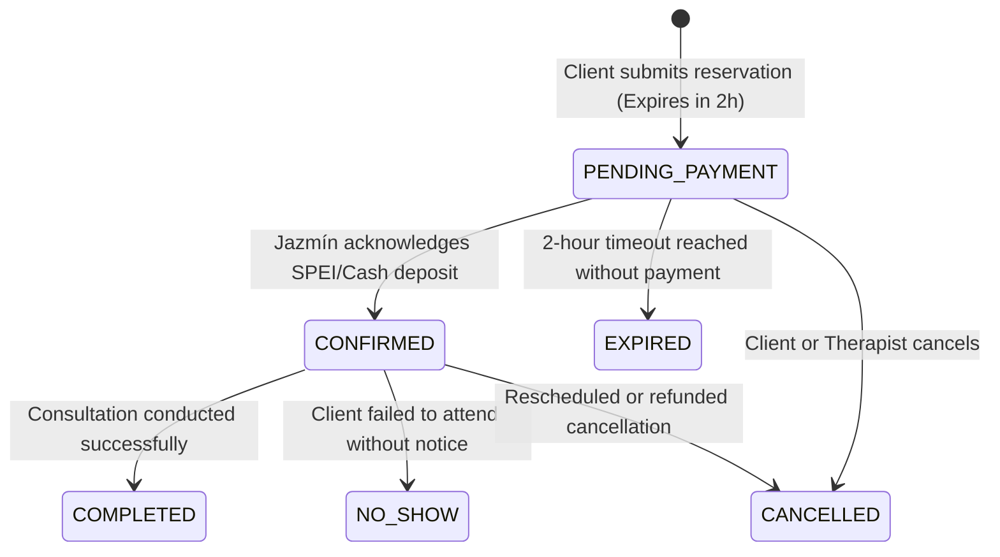
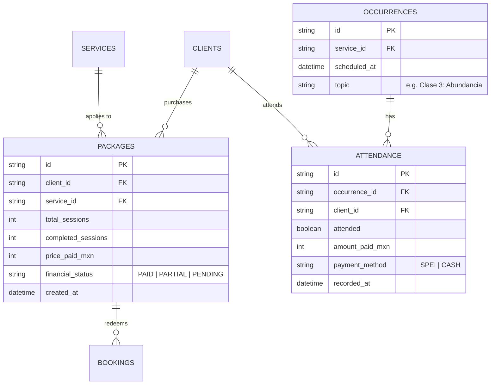

# System Architecture & Technical Design

## Service: `armonia-api`

---

## 1. High-Level Component Topology

```
┌─────────────────────────────────┐       ┌─────────────────────────────────┐
│        armonia-landing          │       │        armonia-dashboard        │
│   (Public Client Experience)    │       │     (Jazmín & Assistant UI)     │
│    Cloudflare Pages (Edge)      │       │     Cloudflare Pages (Edge)     │
└────────────────┬────────────────┘       └────────────────┬────────────────┘
                 │ (Public Booking Flow)                   │ (Admin & Payment Actions)
                 ▼                                         ▼
┌───────────────────────────────────────────────────────────────────────────┐
│                    armonia-api (FastAPI / Python 3.13)                    │
│                                                                           │
│  ┌───────────────────────┐  ┌──────────────────────┐  ┌────────────────┐  │
│  │   Services & Catalog  │  │  Anti-Ghosting State │  │ Attendance &   │  │
│  │   Catalog Engine      │  │  Machine & Buffers   │  │ Package Ledger │  │
│  └───────────┬───────────┘  └──────────┬───────────┘  └────────┬───────┘  │
│              │                         │                       │          │
│              ▼                         ▼                       ▼          │
│       ┌────────────────────────────────────────────────────────────┐      │
│       │               Database Adapter (libsql-client)             │      │
│       └──────────────────────────────┬─────────────────────────────┘      │
└──────────────────────────────────────┼────────────────────────────────────┘
                                       │
                 ┌─────────────────────┴─────────────────────┐
                 ▼                                           ▼
      [Turso Edge Database]                         [Local SQLite3 File]
    (libsql://armonia-db.turso.io)                   (file:local.db)
```

---

## 2. The Anti-Ghosting Booking State Machine



### Event Transitions & Side-Effects

| Transition | Trigger | Calendar Side-Effect | Notification / WhatsApp |
| :--- | :--- | :--- | :--- |
| `-> PENDING_PAYMENT` | Client submits reservation | Creates tentative event `[PENDIENTE] Nombre` (Yellow) | Pre-fills `wa.me` message with CLABE and Folio `ADS-XXXX` |
| `PENDING -> CONFIRMED` | Jazmín taps "Acreditar Pago" | Updates event to `[CONFIRMADO] Nombre` (Green) + Meet link | Sends confirmation message to client |
| `PENDING -> EXPIRED` | Background sweep (timeout) | Deletes tentative hold event | Frees slot for other clients |
| `CONFIRMED -> NO_SHOW` | Post-session audit | Marks status as `NO_SHOW` in audit log | Records history for future booking policies |

---

## 3. Buffer-Time Collision Prevention Algorithm

To resolve consultation overruns, individual appointment availability enforces a post-session buffer:

$$\text{Blocked Interval} = [\text{Start Time}, \text{Start Time} + \text{Duration} + \text{Buffer (15 min)}]$$

```
[Consultation Slot: 10:00 - 11:00] + [Buffer: 11:00 - 11:15]
                                                              Next Available: 11:15
```

When checking availability for a requested slot $[T_{start}, T_{end}]$:
1. Fetch existing bookings on the requested day where status $\in \{\text{PENDING\_PAYMENT}, \text{CONFIRMED}\}$.
2. Fetch busy blocks from Google Calendar API.
3. Compute overlap:
   $$\text{Overlap} \iff \max(T_{start}, E_{start}) < \min(T_{end} + \text{Buffer}, E_{end})$$
4. If overlap detected, slot is rejected as unavailable.

---

## 4. Multi-Session Package & Course Attendance Schema



---

## 5. Future Extensibility: MCP & LLM Agent Readiness

The business layer is implemented as pure Python service functions returning Pydantic domain models, completely independent of the FastAPI routing layer.

This enables future exposure via:
1. **Model Context Protocol (MCP)**: An MCP server exposing tools (`list_available_slots`, `reserve_session`, `verify_payment`, `get_client_package_status`) directly to Claude, Cursor, or Antigravity agents.
2. **WhatsApp AI Bot**: A webhook listening to incoming WhatsApp messages from clients, querying `armonia-api` for availability, and answering booking inquiries conversationally.
